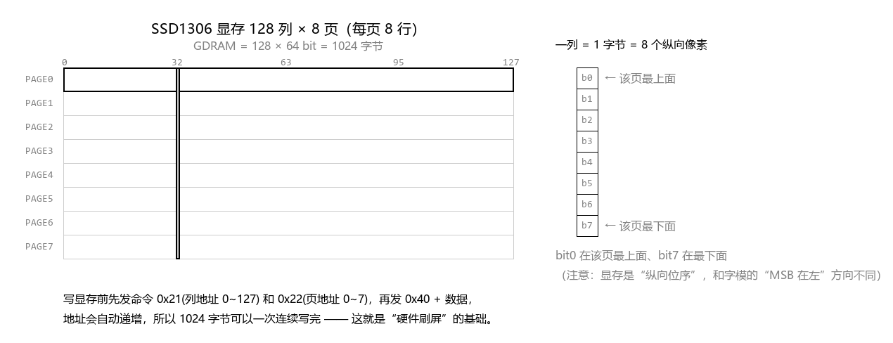
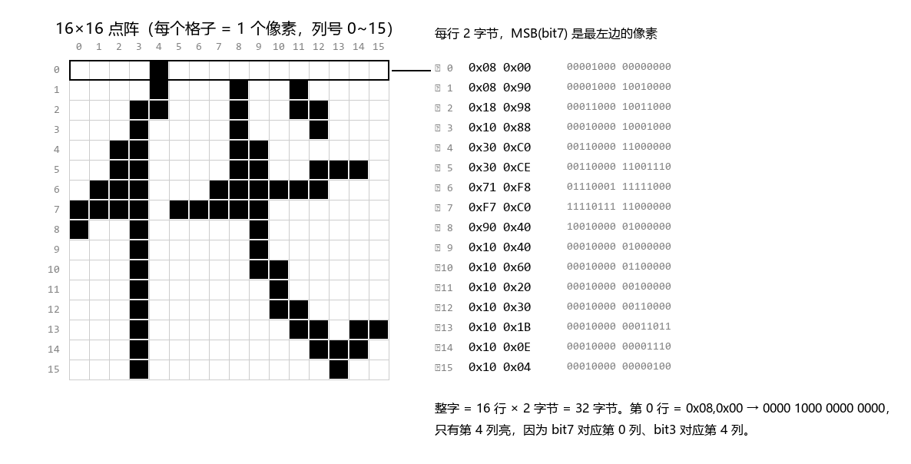
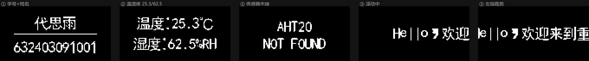
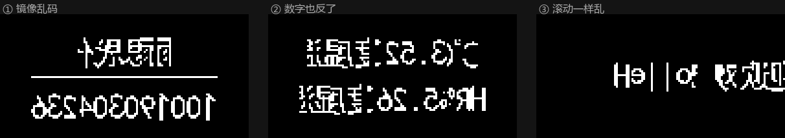
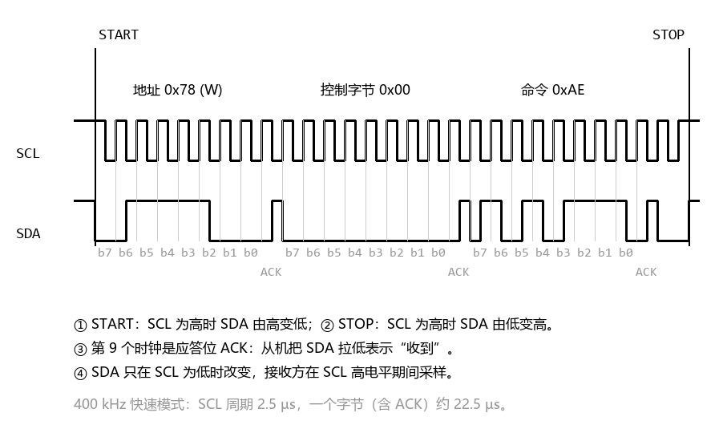
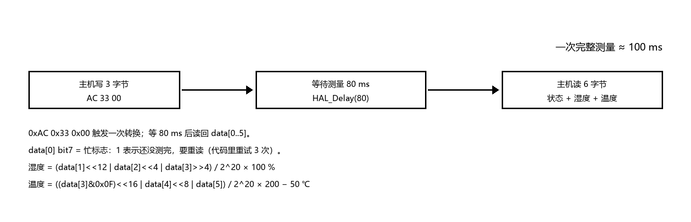
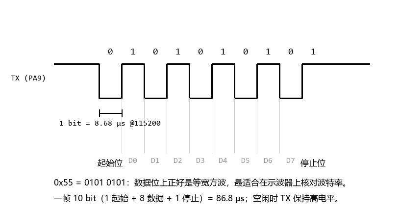
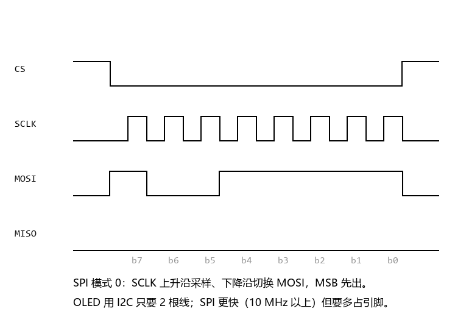
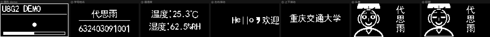
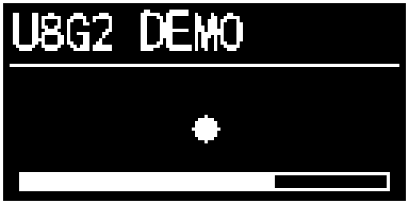

# 实验 6 实验报告：OLED 屏显、汉字点阵编码与 U8g2 移植

| 项目 | 内容 |
|---|---|
| 姓名 | 代思雨 |
| 学号 | 632403091001 |
| 班级 | 物联网 205 |
| 实验平台 | STM32F103C8T6 最小系统板 + 0.96" OLED(SSD1306, I2C) + AHT20 |
| 开发环境 | Keil MDK-ARM 5.37 (AC6 armclang) + STM32Cube HAL + U8g2 |
| 辅助工具 | ST-Link V2、USB-TTL、Saleae Logic 16、示波器 |
| 工程 | `stm32-oled-hal`（GitHub 仓库见文末） |

---

## 一、实验目的

1. 了解 I2C 协议的基本原理和时序协议（START / 地址 / ACK / 数据 / STOP），能在示波器或逻辑分析仪上认出这些时序。
2. 掌握 0.96 寸 OLED 屏（SSD1306）的工作原理、显存组织方式，以及汉字点阵的编码规则与显示原理。
3. 掌握开源 GUI 库 U8g2 在 STM32 上的裁剪、移植与编译方法，以及图形界面可视化技术（图形、文字、滚动、动画）。
4. 通过示波器和逻辑分析仪测量 I2C / SPI / 串口信号，把"代码里发了什么"与"线上跑了什么"对应起来。
5. 会判断仿真器的局限：理解为什么 Keil 的虚拟逻辑分析仪看不到真实 I2C 波形，并知道可替代的验证手段。

---

## 二、实验环境与硬件连接

### 2.1 器材

| 器材 | 型号/规格 | 用途 |
|---|---|---|
| 主控 | STM32F103C8T6（72 MHz，64 KB Flash / 20 KB RAM） | 运行程序 |
| 显示屏 | 0.96 寸 OLED，SSD1306，128×64，7 位地址 0x3C | 显示 |
| 温湿度 | AHT20，7 位地址 0x38 | 采集环境数据 |
| 调试器 | ST-Link V2（SWD） | 下载 / 调试 |
| 串口 | USB-TTL（CH340） | 调试信息输出 |
| 逻辑分析仪 | Saleae Logic 16（16 通道，最高 100 MS/s） | 协议采集与解码 |
| 示波器 | 100 MHz 双通道 | 测位宽、上升沿 |

### 2.2 接线

| 器件 | 信号 | STM32 引脚 | 说明 |
|---|---|---|---|
| OLED | SCL | PB8 | I2C1（**重映射**），需先开 AFIO 时钟再 `__HAL_AFIO_REMAP_I2C1_ENABLE()` |
| OLED | SDA | PB9 | 同上，复用开漏 |
| AHT20 | SCL | PB10 | I2C2 |
| AHT20 | SDA | PB11 | I2C2 |
| 调试串口 | TX | PA9 | USART1，115200 8N1 |
| 调试串口 | RX | PA10 | 只发不收也可 |
| 逻辑分析仪 | CH0/CH1/CH2 + GND | PB8 / PB9 / PA9 / GND | **GND 必须共地**，否则波形全是噪声 |

> 两个模块都自带 4.7 kΩ 上拉电阻，直接接 3.3 V 即可；AHT20 也可以和 OLED 并到同一条 I2C1 总线上（地址不冲突），程序启动时会自动探测两条总线。

---

## 三、任务 1：OLED 屏显 + 汉字点阵 + AHT20（I2C）

任务要求：用 STM32F103 的 I2C（或 SPI）接口驱动 0.96 寸 OLED，完成 ① 学号姓名、② AHT20 温湿度、
③ 左右/上下滑动显示长字符串（最好用硬件刷屏）三项功能。本工程用 **I2C1（PB8/PB9，重映射）** 接屏。

### 3.1 OLED 屏是怎么显示图像的

0.96 寸屏的驱动芯片是 **SSD1306**，分辨率 128×64。它不是"按像素"给你写的，而是把屏幕切成
**8 个页（PAGE0~PAGE7）**，每页高 8 像素：



*图 3-1　SSD1306 的显存组织：128 列 × 8 页，一列 1 字节 = 8 个纵向像素*

| 概念 | 说明 |
|---|---|
| 显存大小 | 128 × 64 bit = **1024 字节**（GDDRAM） |
| 地址方式 | 页地址 0~7 + 列地址 0~127 |
| 一个字节的含义 | 某一列的 8 个**纵向**像素，`bit0` 在该页最上面、`bit7` 在最下面 |
| 寻址模式 | 水平寻址（0x20,0x00）：写完一列自动 +1 列，到列尾自动换页 |

所以"点亮 (x, y) 这个像素"在显存里的地址是：

```
页 = y / 8      列 = x      位 = y % 8
byte[页 * 128 + 列] |= (1 << 位)
```

写显存时，I2C 事务里的第一个字节是**控制字节**：`0x00` 表示后面是命令，`0x40` 表示后面是显存数据。
先发命令设置列/页地址，再发 `0x40` + 数据，地址会自动递增，因此**1024 字节可以一次连续写完**——
这正是任务里说的"硬件刷屏"的基础，3.5 节展开。

### 3.2 汉字点阵编码原理

汉字在屏上是**画出来的图形**，不是字体渲染。工程里用取模软件把每个汉字做成 16×16 的点阵，按
**逐行存放、每行 2 字节、MSB 在左**的格式保存：



*图 3-2　16×16 汉字"代"的点阵与它的 32 个字节的对应关系*

以第一行为例：`0x08, 0x00` → 二进制 `0000 1000 0000 0000`，只有第 4 列是 1，所以第 0 行只有
第 4 个像素亮。一个汉字 16 行 × 2 字节 = **32 字节**，ASCII 字符 8×16 则是 16 行 × 1 字节 = **16 字节**。

用取模软件（PCtoLCD2002 等）时，参数必须和代码里的解算方式一致：

| 设置项 | 本工程取值 | 如果选错会怎样 |
|---|---|---|
| 阴码 / 阳码 | 阴码（1 = 点亮） | 显示成"反白" |
| 取模走向 | 逐行式 | 字被旋转 90° |
| 字节内位序 | 高位在前（MSB 在左） | 每个 8 像素块左右翻转（见 3.6） |

字库在代码里就是一个结构体数组，按 UTF-8 的前 3 个字节查表：

```c
typedef struct { const char name[4]; const uint8_t data[32]; } Font16_t;

const Font16_t font16_tab[] = {
    {"代", {0x08,0x00, 0x08,0x90, 0x18,0x98, ...}},
    {"思", {0x00,0x00, 0x3F,0xFC, 0x31,0x8C, ...}},
    ...
};

const uint8_t *font16_find(const char *hz)   /* 按 3 字节线性查找，找不到返回 NULL */
```

本工程字库规模：**25 个汉字（900 字节）+ 95 个 ASCII（1520 字节）**，比 u8g2 自带的上 MB 字库小得多。

### 3.3 功能①：显示学号 + 姓名

姓名是汉字（16 px 宽），学号是 ASCII（8 px 宽），所以要先按 UTF-8 逐字符判断宽度，算总宽再居中：

```c
static uint8_t utf8_len(const char *s)     /* ASCII=1、汉字=3、其它=2/4 */
static int     str_width(const char *s)    /* ASCII 8px，其它 16px */

static void draw_str_center(u8g2_t *u, int y, const char *s)
{
    draw_str(u, (OLED_W - str_width(s)) / 2, y, s);
}

show_id():
    draw_str_center(&u8g2, 12, "代思雨");        /* 3×16 = 48 px，居中在 x=40 */
    u8g2_DrawHLine(&u8g2, 16, 32, 96);           /* 分隔线 */
    draw_str_center(&u8g2, 40, "632403091001");  /* 12×8 = 96 px，居中在 x=16 */
```



*图 3-3　任务 1 的三个画面：学号姓名 / 温湿度 / 滚动（含左端裁剪）*

### 3.4 功能②：显示 AHT20 温湿度

AHT20 挂在 I2C2（PB10/PB11），7 位地址 0x38（HAL 用 8 位地址 0x70/0x71）。它不是"读寄存器"，
而是**触发一次转换 → 等它算完 → 再读结果**：

```c
HAL_I2C_Master_Transmit(hi2c, 0x70, (uint8_t[]){0xAC,0x33,0x00}, 3, 20);  /* 触发 */
HAL_Delay(80);                                                            /* 等转换 */
HAL_I2C_Master_Receive (hi2c, 0x71, data, 6, 20);                         /* 读 6 字节 */
```

读回的 6 个字节里，湿度和温度各占 20 bit：

```
湿度 = (data[1]<<12 | data[2]<<4 | data[3]>>4) / 2^20 × 100 %RH
温度 = ((data[3]&0x0F)<<16 | data[4]<<8 | data[5]) / 2^20 × 200 − 50 ℃
```

STM32F103C8 没有 FPU，用浮点会引入几百字节的软浮点库，所以全部用定点整数（结果 ×10）：

```c
*humi_x10 = (uint16_t)(((raw_h * 1000UL) + 524288UL) / 1048576UL);        /* +524288 = 四舍五入 */
*temp_x10 = (int16_t)(((raw_t * 2000UL) + 524288UL) / 1048576UL) - 500;
```

⚠️ 温度这里是 **×2000**（不是 ×1000）：`T×10 = raw/2^20 × 2000 − 500`。写成 1000 会让 25℃ 显示成
−12.5℃，这是本次排错发现的一个真 bug（见 3.6）。

显示时先格式化成 `"25.3"` 这样的字符串，再按"标签 + 数值 + 单位"三段居中排：

```c
wl = 40;                                   /* "温度:" = 2×16 + 8 */
wv = fmt_x10(val, t_x10) * 8;              /* "25.3" = 4×8 */
ws = 16;                                   /* "℃" */
x  = (OLED_W - (wl + wv + ws)) / 2;
```

传感器没接或读取失败时显示 `AHT20 / NOT FOUND`（用 ASCII 是因为字库里没有"未连接"这三个字，
写中文只会显示空白）。

### 3.5 功能③：滑动显示与"硬件刷屏"

**滑动的本质就是改绘制起点**，每帧清屏重画一次，靠人眼视觉暂留形成连续移动：

```c
/* 左右滚动：从右侧屏外 (x = w+128) 走到左侧屏外 (x = -w) */
const int frames = (2 * w + OLED_W + step - 1) / step + 1;
for (int f = 0; f < frames; f++) {
    u8g2_ClearBuffer(&u8g2);
    draw_str(&u8g2, (w + OLED_W) - f * step, 24, msg);
    u8g2_SendBuffer(&u8g2);              /* 整屏 1024 字节一次刷出 */
    HAL_Delay(8);
}

/* 上下滚动：只改 y，从 64 走到 -16（负坐标由 draw_bitmap 的裁剪兜住） */
for (int y = OLED_H; y >= -16; y -= step) {
    u8g2_ClearBuffer(&u8g2);
    draw_str(&u8g2, x, y, msg);
    u8g2_SendBuffer(&u8g2);
    HAL_Delay(8);
}
```

**什么叫"硬件刷屏"**：u8g2 的全缓冲 f 模式把一帧的画面先在 STM32 的 RAM 里拼好（1024 字节），
然后 `u8g2_SendBuffer()` 一次写进 SSD1306 的显存 —— 命令层只发 `0x21`（列范围）、`0x22`（页范围），
之后就是 `0x40 + 数据` 连续写，靠控制器的**地址自动递增**跑完全屏。对比：

| | 逐页软件刷新 | 整屏缓冲刷新（本工程） |
|---|---|---|
| 写显存方式 | 每页一写，页内按列写 | 1024 字节连续写，地址自增 |
| I2C 事务数 | 8 页 × 若干次，命令多 | 约 4 次命令 + 43 次数据 |
| 画面效果 | 逐页刷新，可能看到撕裂/闪 | 一次成型，无撕裂 |
| RAM 占用 | 不需要帧缓冲 | 1024 字节 |
| 编程模型 | 自己算页/列/位 | `ClearBuffer → 画图 → SendBuffer` |

一帧的时间可以算出来：每字节（含 ACK）9 bit，400 kHz 下 22.5 µs，1024 字节 ≈ 23 ms；加上 43 个
控制字节、43 个从机地址字节和 START/STOP 开销，实测约 **26 ms/帧**，即理论上限约 38 fps。
实际滚动用了 2 像素/帧 + 8 ms 延时，约 20 fps，均匀不闪。

本工程的滚动字符串宽 352 px（"Hello" 40 + "，" 16 + 13 个汉字 208 + "205" 24 + "实训室" 48 + "！" 16），
2 px/帧 → 417 帧 → 约 20 s 走完一遍。

### 3.6 任务 1 的排错记录

初版代码能编译通过，但屏上根本看不清。逐个定位后修了 4 个问题：

| # | 现象 | 原因 | 解决 |
|---|---|---|---|
| 1 | 所有字左右镜像，汉字被劈成两半 | 字模是"逐行 + MSB 在左"，而 `u8g2_DrawXBM()` 按 XBM 规范读 **LSB 在左** | 不用 DrawXBM，自己写 `draw_bitmap()` 逐像素画，负坐标分支也统一成 MSB |
| 2 | 温度显示 −12.5℃（实际 25℃） | 温度公式 `×2000` 写成了 `×1000`，等于算了一半再减 50 | 改成 `raw_t*2000/2^20 − 500` |
| 3 | 数字中间出现实心黑方块 | 字库里 `.` `,` `'` `@` `_` 的数据是坏的（解出来是一整块） | 按同一格式重写这 7 个字模 |
| 4 | 滚动到最后右边残留几列 | 帧数少算一帧，最后一帧停在 x = 2−w | 帧数改为向上取整 +1 |

其中第 1 个最隐蔽：字模本身没错、接线也没错，只是"位序"约定不一致。修正前后对比：



*图 3-4　修正前的效果（同一份字模按 LSB 解释，即 `u8g2_DrawXBM` 的实际行为）*

### 3.7 任务 1 小结

三项功能全部实现，并通过逐像素还原的方式核对了每一屏的实际显示效果：

- 掌握了 SSD1306 的"页 + 列"显存模型，以及 `0x00/0x40` 控制字节的作用；
- 独立完成了 16×16 汉字与 8×16 ASCII 的取模、字库组织与 UTF-8 查表；
- 理解并实现了"整屏缓冲 + 一次连续写"的硬件刷屏，算清了 I2C 带宽与帧率的关系；
- 排掉 4 个典型 bug，尤其是"位序不一致导致镜像"这一类最容易被忽略的错误。

---

## 四、任务 2：I2C / SPI / 串口信号测量与分析

> 本次任务的波形图是**按代码实际发送的字节和时序参数重建**的，用于把协议和代码对上；真实测量数据用示波器/Saleae 采到后填进 4.6 节的表格即可。

### 4.1 为什么要看波形

代码里的 `HAL_I2C_Master_Transmit(&hi2c1, 0x78, buf, n, 25)` 只是一行调用，它到底在两根线上发生了什么？只有看到波形才能确认：

- 起始/停止条件是否合规（SCL 高电平期间 SDA 跳变）；
- 从机地址是 7 位左移后的 0x78，还是误写成 0x3C；
- 每字节后面有没有 ACK（从机拉低 SDA）；
- 400 kHz 有没有真的跑起来（位宽 2.5 µs）。

### 4.2 I2C：一次命令事务

以 OLED 初始化时发"关显示"命令 0xAE 为例，线上是这样一串事务：



*图 4-1　一次 I2C 写事务：START → 0x78+ACK → 0x00+ACK → 0xAE+ACK → STOP*

逐段对照代码：

| 波形上的段 | 线上字节 | 代码里对应 |
|---|---|---|
| START | SCL 高时 SDA 由高变低 | `HAL_I2C_Master_Transmit()` 内部产生 |
| 第 1 字节 | `0x78` = 0x3C<<1（最低位 0 表示写） | `u8x8->i2c_address`，u8g2 默认 0x78 |
| ACK | 第 9 个时钟 SDA 被从机拉低 | 从机（SSD1306）应答 |
| 第 2 字节 | `0x00` | **控制字节**：0x00 表示后面是命令，0x40 表示后面是显存数据 |
| 第 3 字节 | `0xAE` | 命令本体（关显示） |
| STOP | SCL 高时 SDA 由低变高 | 事务结束 |

要点：**SSD1306 的 I2C 事务里，第一个字节永远是"控制字节"**，它决定后面跟的是命令还是显存数据。这也是 u8g2 的 `ssd13xx_fast_i2c` CAD 层帮我们做的事——它把每条命令、每个数据块都包成"控制字节 + 数据"的一次完整事务。

### 4.3 一帧刷屏到底发了多少次事务

U8g2 全缓冲模式下 `u8g2_SendBuffer()` 要写 128×64/8 = **1024 字节**显存。CAD 层每次最多带 24 字节数据（为了兼容 Arduino 的 32 字节 Wire 缓冲），于是：

- 数据事务：⌈1024 / 24⌉ = **43 次**（42 次 ×24 字节 + 1 次 ×16 字节）；
- 命令事务：设置列地址 0x21、页地址 0x22 等，约 **4 次**；
- 合计约 **47 次** I2C 事务。

按 400 kHz 算，每字节（含 ACK）9 bit ≈ 22.5 µs，一次 24 字节数据事务 ≈ 26 字节 ≈ 0.6 ms，43 次 ≈ 25.5 ms；再加上命令和 Start/Stop 开销，**一帧约 26 ms，理论帧率 ~38 fps**。实际代码里还有 `HAL_Delay`，所以滚动约 20 fps。

这个数字和示波器上量到的"一次 `SendBuffer` 的耗时"应该能对上——这也是判断"到底是 I2C 慢还是代码慢"的依据。

### 4.4 AHT20 的测量时序

AHT20 不是"读寄存器"，而是"触发一次转换 → 等它算完 → 再读结果"：



*图 4-2　AHT20 一次完整测量约 100 ms*

代码 `AHT20_ReadData()` 里：

```c
HAL_I2C_Master_Transmit(hi2c, 0x70, cmd, 3, 20);   /* 0xAC 0x33 0x00 触发 */
HAL_Delay(80);                                     /* 必须等，不能省 */
HAL_I2C_Master_Receive(hi2c, 0x71, data, 6, 20);   /* 读 6 字节 */
if ((data[0] & 0x80) != 0) { /* bit7=1 还在忙，重读 */ }
```

**为什么这 80 ms 不能省**：转换是传感器内部 ADC 完成的，期间它不会应答数据读取。如果不等，读回的是上一次的旧数据或全 0，表现为"温度一直是同一个值"。用逻辑分析仪看，就是两次事务之间有一条 80 ms 的空隙——这条空隙本身就是"我在等传感器"的直接证据。

### 4.5 串口（USART1，115200 8N1）

工程里加了 USART1 做调试输出，开机先发 8 个 `0x55`：



*图 4-3　0x55 的 8N1 帧：起始位 + 8 数据位（低位先发）+ 停止位*

选 `0x55` 是有意的：它的二进制是 `0101 0101`，在数据位上正好是**等宽方波**，用示波器测出一个位的宽度就能反算波特率：

```
位宽 = 1 / 115200 = 8.68 µs
一帧 = 10 bit = 86.8 µs
```

实测时如果量到 8.7 µs 左右，说明波特率正确；如果量到 17 µs，说明实际是 57600（分频算错）；如果波形是乱的，多半是**没共地**或者 TX/RX 接反。

串口输出内容示例：

```
[BOOT] OLED + U8g2 demo, UART 115200 8N1
[AHT20] T=25.3C  H=62.5%RH
[AHT20] T=25.4C  H=62.4%RH
```

### 4.6 SPI 作为对照

同样是把一字节送出去，SPI 的波形是这样的：



*图 4-4　SPI 模式 0 发 0x9F：CS 拉低 → 8 个 SCLK → MOSI 上 MSB 先出*

对比结论：

| | I2C | SPI |
|---|---|---|
| 线数 | 2（SCL/SDA）+ 上拉 | 4（SCK/MOSI/MISO/CS） |
| 速率 | 400 kHz（本工程） | 可达 10 MHz 以上 |
| 寻址 | 有，7 位地址 + ACK | 无，靠 CS 选片 |
| 一帧 1024 字节 | ≈ 26 ms | ≈ 1 ms |
| 0.96" OLED 模块 | ✔ 常见 | 也有（7 针 SPI 版） |

这块屏是 I2C 版（4 针），所以只能走 I2C；如果换成 7 针 SPI 版，U8g2 只要把 `u8g2_Setup_ssd1306_i2c_128x64_noname_f` 换成 `..._spi_...` 版本即可，其余代码不用改——这正是用 U8g2 的好处。

### 4.7 Saleae Logic 16 实测步骤

1. **装软件**：装 Logic 2（新版）。旧版软件目录里带一份中文指南，里面有一个"串口分析"的完整案例（接 TX、设波特率、看解码结果），建议先照着走一遍，熟悉"采集 → 加分析器 → 读解码表"的流程。
2. **接线**：GND 一定要接；CH0 → PB8(SCL)，CH1 → PB9(SDA)，CH2 → PA9(TX)。
3. **采样率**：I2C 是 400 kHz，按"至少 10 倍"原则取 **≥ 4 MS/s**，实际建议设 **12 MS/s**（Logic 16 通道多时最高采样率会下降，够用即可）。
4. **加分析器**：
   - I2C：SCL = CH0，SDA = CH1，地址显示选 **7 位**（这样看到的就是 0x3C）；
   - UART：CH2，115200，8 数据位，无校验，1 停止位。
5. **触发**：I2C 选 "Start condition" 触发，或者用 SDA 下降沿；单次采集时间设 100 ms 以上，才能抓到一整帧刷屏。
6. **读结果**：解码表里应该看到 `0x3C W 0x00 0xAE`、`0x3C W 0x40 <数据…>` 这样的行。把解码表截图放进报告。

预期解码结果（一帧刷屏开头）：

| # | 地址 | 方向 | 第 1 字节 | 后续 | 含义 |
|---|---|---|---|---|---|
| 1 | 0x3C | W | 0x00 | 0x21 0x00 0x7F | 设置列地址 0~127 |
| 2 | 0x3C | W | 0x00 | 0x22 0x00 0x07 | 设置页地址 0~7 |
| 3 | 0x3C | W | 0x40 | 24 字节显存数据 | 第 1 块像素 |
| … | 0x3C | W | 0x40 | … | 共 43 块 |
| 46 | 0x3C | W | 0x00 | 0xAF | 开显示（初始化时） |

> 说明：上表是按 u8g2 SSD1306 驱动的实际行为推导的，实测以 Saleae 解码结果为准。

### 4.8 问题 2：Keil 虚拟逻辑分析仪看 I2C 会是什么样子？

**结论：基本看不到有效波形——只会是两条直线（或者干脆没有变化）。**

原因有四层：

1. **虚拟逻辑分析仪只在 `Use Simulator` 模式下工作**。它显示的不是真实引脚电压，而是仿真器算出来的"逻辑电平"。GPIO 输出可以用 `PORTA.8`、`PORTB.9` 这样的表达式观察，因为 GPIO 模型会把 ODR/BSRR 的写入反映到引脚上。
2. **我们用的是硬件 I2C（复用功能）**。引脚被设成 `GPIO_MODE_AF_OD` 之后，由 I2C 外设的移位寄存器驱动。Keil 的 I2C 模型只实现"寄存器 + 状态机"层面的行为（写 DR、查 SR 标志），并**不会把移位寄存器里的位流映射回引脚电平**，所以逻辑分析仪上即便加了 `I2C1_SDA`，也没有波形可画。
3. **更致命的是：仿真器里没有 SSD1306 这个从机**。`HAL_I2C_Master_Transmit()` 是**轮询等待**：等 SB → 发地址 → 等 ADDR（要等从机 ACK）→ 发数据 → 等 BTF。没有从机就不会置 ADDR 位，程序会一直卡在这个 `while` 里直到 25 ms 超时，**主循环根本走不到刷屏那一步**，波形自然停在空闲高电平。
4. **时间精度也没有意义**。400 kHz 的位宽只有 1.25 µs，而仿真器按指令周期推进时间，画出来的"位宽"跟真实硬件差着数量级，用来验证时序没有价值。

**能看到的特殊情况**：如果把 I2C 改成 **GPIO 软件模拟（bit-bang）**，每一位都是对 `GPIOB->BSRR` 的写，仿真器就能算出引脚电平，逻辑分析仪上就能看到完整的 START / 地址 / 数据 / STOP ——这时它是能用的。代价是软件模拟的速度只有几十 kHz 到 100 kHz，而且占用 CPU。

**那用什么替代？**

| 方法 | 做法 | 优点 | 局限 |
|---|---|---|---|
| ① 真实逻辑分析仪 | Saleae Logic 16 接 SCL/SDA/GND，加 I2C 解码器 | 直接看到地址/数据/ACK，最权威 | 要硬件 |
| ② 示波器双通道 | CH1=SCL、CH2=SDA，用 SDA 下降沿触发抓 START | 能测位宽、上升时间、看毛刺 | 只能看几微秒窗口，解不出整包 |
| ③ 软件打点 | 软件模拟 I2C 后再进 Keil 仿真 + 逻辑分析仪 | 不用硬件就能看波形 | 速度慢，只适合教学演示 |
| ④ 串口打印事务 | 在 `u8x8_byte_hw_i2c()` 的 END_TRANSFER 里把地址、长度、耗时打印出来 | 零成本，能看清"发了多少、花了多久" | 不是电气层，看不到 ACK/毛刺 |
| ⑤ GPIO 打点测时间 | 事务前后翻转一个空闲引脚（如 PA8），示波器量脉宽 | 能精确量一次刷屏的耗时 | 只能得到时间，不含内容 |
| ⑥ 离线还原 | 按 u8g2 的调用序列重建波形（本报告 4.2~4.5 的图） | 用来核对"代码发的字节对不对" | 不是实测，不能代替硬件 |

本报告选择了 ①（后续实测）+ ⑥（现在先把协议和代码对上）两条路：波形图保证"该发什么"是对的，Saleae 负责验证"实际发了什么"。

---

## 五、任务 3：CubeMX + U8g2 裁剪移植

### 5.1 CubeMX 配置

按下面的配置生成 HAL 工程骨架（工程结构与本项目一致：`Core/Inc`、`Core/Src`、`Drivers`，工具链选 MDK-ARM V5）：

| 配置页 | 项目 | 设置 |
|---|---|---|
| Pinout | RCC | HSE = Crystal/Ceramic Resonator（8 MHz） |
| Pinout | SYS | Debug = Serial Wire |
| Pinout | I2C1 | I2C，Speed Mode = Fast Mode，400 kHz；引脚改到 **PB8/PB9**（重映射） |
| Pinout | I2C2 | I2C，Fast Mode，400 kHz（PB10/PB11） |
| Pinout | USART1 | Asynchronous，115200，8N1（PA9/PA10） |
| Clock | HCLK | 72 MHz（PLL ×9，APB1 = 36 MHz，APB2 = 72 MHz） |
| Project | Toolchain | MDK-ARM V5 |
| Project | Code Generator | 勾选 "Generate peripheral initialization as a pair of .c/.h files" |

生成后，把 U8g2 源码放进 `U8g2/` 目录，在 Keil 里加入工程（本工程的做法），或者用 CubeMX 的 "Add additional source folder"。

> 说明：本工程是把 CubeMX 生成的骨架代码整理进 `main.c`（保留了 `HAL_Init → SystemClock_Config → MX_xxx_Init → while(1)` 的结构和 `Error_Handler()`），再手工加入 U8g2、字库和 AHT20 驱动。

### 5.2 U8g2 裁剪

完整的 u8g2 有 1 MB 以上的字库（`u8g2_fonts.c`）和几十种驱动，直接全加进 64 KB Flash 的 F103 会爆。裁剪原则：**只留 SSD1306 128×64 I2C 全缓冲模式用到的那几个模块**。

保留（必须）：

| 文件 | 作用 |
|---|---|
| `u8g2_setup.c` / `u8g2_buffer.c` | 初始化、显存缓冲、SendBuffer |
| `u8g2_hvline.c` / `u8g2_ll_hvline.c` | 画点/线，所有图形的基础 |
| `u8g2_bitmap.c` | DrawXBM / DrawBitmap |
| `u8g2_box.c` / `u8g2_circle.c` / `u8g2_line.c` | 矩形、圆、直线（demo 用） |
| `u8g2_intersection.c` | 裁剪判断 |
| `u8g2_d_setup.c` / `u8g2_d_memory.c` | 驱动注册表、1024 字节显存缓冲 |
| `u8x8_setup.c` / `u8x8_display.c` / `u8x8_byte.c` / `u8x8_cad.c` / `u8x8_gpio.c` | 底层通信框架 |
| `u8x8_d_ssd1306_128x64_noname.c` | SSD1306 128×64 驱动 |

删除（本工程不用）：

- `u8g2_fonts.c`（内置字库，约 1 MB）—— 这就是为什么本工程用**自建 8×16 ASCII + 16×16 汉字字库**，只占 6.5 KB；
- `u8x8_8x8.c`、`u8x8_string.c`、`u8x8_u16toa.c`（旧版 8×8 字符接口）、`u8g2_kerning.c`、`u8g2_font.c`（不用内置字体时的字体解码）。

Keil 里再加 `--split_sections`（Misc Controls），链接器会把没用到的函数裁掉。

裁剪后资源占用（armlink 实测）：

```
Total RO  = 25080 B (24.49 kB)   含代码 + 字库 + 头像点阵
Total RW  =  3136 B ( 3.06 kB)   含 1024 B 显存 + 栈
Total ROM = 25092 B (24.50 kB)   / 64 kB Flash，余量充足
```

### 5.3 移植的三个回调

U8g2 只要求用户提供两个函数，硬件平台就"接上"了：

```c
/* 1. 字节传输：把 CAD 层一次性要发的内容攒起来，END 时发出去 */
uint8_t u8x8_byte_hw_i2c(u8x8_t *u8x8, uint8_t msg, uint8_t arg_int, void *arg_ptr)
{
    switch (msg) {
    case U8X8_MSG_BYTE_START_TRANSFER:  u8x8_txlen = 0; break;
    case U8X8_MSG_BYTE_SEND:            /* 追加到缓冲 */
    case U8X8_MSG_BYTE_END_TRANSFER:    /* 一次 HAL_I2C_Master_Transmit 发完 */
    }
}

/* 2. 延时：u8g2 初始化时要 ms 级延时 */
uint8_t u8x8_gpio_and_delay(u8x8_t *u8x8, uint8_t msg, uint8_t arg_int, void *arg_ptr)
{
    if (msg == U8X8_MSG_DELAY_MILLI) HAL_Delay(arg_int);
    ...
}
```

为什么用"缓冲式"而不是"每个字节发一次"？因为 SSD1306 的协议把控制字节（0x00/0x40）和数据放在**同一次事务**里，如果逐字节 `HAL_I2C_Master_Transmit`，会在每个字节之间插入 START/STOP，从机解析就会错位，而且速度慢一个数量级。

### 5.4 六个显示画面



*图 5-1　① U8g2 图形 demo　② 学号姓名　③ 温湿度　④ 左右滚动　⑤ 上下滚动　⑥ 头像动画*

**① U8g2 demo**：外框 `DrawFrame` + 标题 + 分隔线 `DrawLine` + 弹跳小球 `DrawDisc` + 进度条 `DrawBox`，用 `HAL_GetTick()` 控制 6 秒。



*图 5-2　U8g2 图形 demo：小球在框内弹跳，底部进度条随时间填充*

**② 学号姓名**：`draw_str_center(&u8g2, 12, "代思雨")` + `DrawHLine` + 学号。

**③ 温湿度**：读 AHT20 → 格式化 → 两条居中显示；传感器没接时显示 `AHT20 / NOT FOUND`（用 ASCII 是因为字库里只有 25 个汉字，写中文会变空白）。

### 5.5 上下 / 左右滚动的实现

滚动的本质就是**改变绘制起点坐标**，每一帧清屏重画：

```c
/* 左右滚动：x 从 w+128（右侧屏外）递减到 -w（左侧屏外） */
for (int f = 0; f < frames; f++) {
    u8g2_ClearBuffer(&u8g2);
    draw_str(&u8g2, (w + OLED_W) - f * step, 24, msg);
    u8g2_SendBuffer(&u8g2);          /* 硬件刷屏 */
    HAL_Delay(delay_ms);
}

/* 上下滚动：y 从 64（下方屏外）递减到 -16（上方屏外） */
for (int y = OLED_H; y >= -16; y -= step) {
    u8g2_ClearBuffer(&u8g2);
    draw_str(&u8g2, x, y, msg);
    u8g2_SendBuffer(&u8g2);
    HAL_Delay(delay_ms);
}
```

两个细节：

1. **负坐标必须能裁掉**。`draw_bitmap()` 里算出了可见范围 `c0/c1/r0/r1`，越界像素直接跳过，所以 x=-7、y=-3 这种坐标也能安全绘制，不会写到屏外。
2. **帧数要算够**。左右滚动的帧数用 `(2*w + 128 + step - 1)/step + 1`，保证最后一帧 `x ≤ -w`；否则文字右边会残留几个像素，看起来"卡住不走了"（这是原代码的一个 off-by-one bug）。

### 5.6 头像点阵与动画

头像是一张 **64×64 单色位图**，按"逐行存放、每字节 MSB 在左"存成 512 字节：

```c
draw_bitmap(&u8g2, 0, y, 64, 64, blink ? avatar_blink : avatar_open);
```

- **两帧动画**：`avatar_open`（睁眼）和 `avatar_blink`（闭眼），每 2.4 s 切到闭眼 220 ms 再切回来，就是"眨眼"；
- **呼吸感**：整体 y 每 450 ms 在 0 和 -1 之间切换，看起来轻轻浮动；
- **画面构成**：左半屏 64×64 头像，右半屏竖排姓名（`代`/`思`/`雨` 各占 16×16）。


*图 5-3　头像的两帧（左：睁眼，右：闭眼）*


*图 5-4　头像画面：64×64 头像 + 右侧竖排姓名*

**自己换头像的方法**：把图片转成 64×64 黑白（阈值二值化）→ 按每行 8 字节、MSB 在左打包 → 替换 `avatar.h` 里的数组。工程里的 `tools/make_avatar.py` 就是做这件事的脚本，改一下绘图代码就能生成新头像。

---

## 六、遇到的问题与解决

| # | 现象 | 原因 | 解决 |
|---|---|---|---|
| 1 | 屏上所有字都是左右镜像，汉字被劈成两半 | 字模是"逐行 MSB 在左"，而 `u8g2_DrawXBM()` 按 XBM 规范读 **LSB 在左** | 不用 DrawXBM，自己写 `draw_bitmap()` 逐像素画；负坐标分支也统一成 MSB |
| 2 | 温度显示成 -12.5℃（实际 25℃） | 温度公式 `×2000` 写成了 `×1000`，等于算了一半再减 50 | 改成 `raw_t*2000/2^20 − 500` |
| 3 | 数字中间出现实心黑方块 | 字库里 `.` 和 `,` 的数据是坏的（画出来是一整块） | 按同一格式重写 `. , ' @ _ ^ \`` 等 7 个字模 |
| 4 | 滚动到最后右边残留几列 | 帧数少算一帧，最后一帧 x = 2-w | 帧数改为向上取整 +1 |
| 5 | AHT20 偶尔显示"未连接" | 初始化只读一次状态、读数据只试一次 | 初始化/读数据各重试 3 次，失败时沿用上次有效值 |
| 6 | 中文提示显示成空白 | 字库里没有那几个汉字 | 提示改用 ASCII（或往字库补字模） |
| 7 | 换头像后编译报 `AVATAR_H` 重定义 | 头文件保护宏和高度宏同名 | 保护宏改成 `AVATAR_H_` |
| 8 | 逻辑分析仪上 I2C 一条直线 | 见 4.8 节：仿真器无从机 + 硬件 I2C 引脚不由 GPIO 模型驱动 | 换真逻辑分析仪；或改软件模拟 I2C |

---

## 七、总结

1. **点阵编码的关键是"位序"**：同一份 32 字节，按"行优先 + MSB 在左"还是"XBM（行优先 + LSB 在左）"解释，出来的图形完全不同。做字库和用别人库的时候，第一件事是确认位序，而不是怀疑接线。
2. **协议要看波形才算真懂**：I2C 的 START/ACK/STOP、AHT20 的 80 ms 等待、串口的起始位/停止位，这些在代码里都是一行调用，但在线上都有明确的电气形态。
3. **U8g2 的价值在于"换屏只换一行"**：应用层只调 `DrawStr/DrawBox/DrawDisc`，底层 `u8x8_byte_*` 换成 SPI 或 GPIO 模拟即可；代价是字库和驱动要裁剪。
4. **仿真器 ≠ 硬件**：Keil 的虚拟逻辑分析仪只能看 GPIO 能反映的信号，硬件外设的引脚波形、外部从机的行为它都模拟不了——这也是为什么任务 2 一定要上真仪器。

---

## 附录 A：工程文件清单

```
stm32-oled-hal/
├── main.c              主程序（六屏显示 + UART 日志 + 时钟/I2C/UART 初始化）
├── aht20.c/.h          AHT20 驱动（双总线探测、重试）
├── font_hz16.c/.h      16×16 汉字点阵（25 字）
├── font_asc8x16.c/.h   8×16 ASCII 点阵（95 字符）
├── avatar.h            64×64 头像点阵（睁眼/闭眼两帧）
├── U8g2/               裁剪后的 u8g2 源码
├── HAL/ Device/ RTE/   STM32F1 HAL 与启动文件
├── docs/               报告插图
├── tools/              字模/波形/预览生成脚本
├── main.uvprojx        Keil 工程
├── 实验报告.md/.pdf     本报告
├── 博客.md              博客稿件
└── README.md           仓库说明
```

## 附录 B：编译信息

```
Compiler : ArmClang V6.18 (Keil MDK 5.37)
Target   : STM32F103C8Tx, Cortex-M3, 72 MHz
Options  : -O1 -ffunction-sections -fdata-sections --split_sections
Result   : 0 Error(s), 0 Warning(s)
Size     : RO 25080 B, RW 3136 B
```
